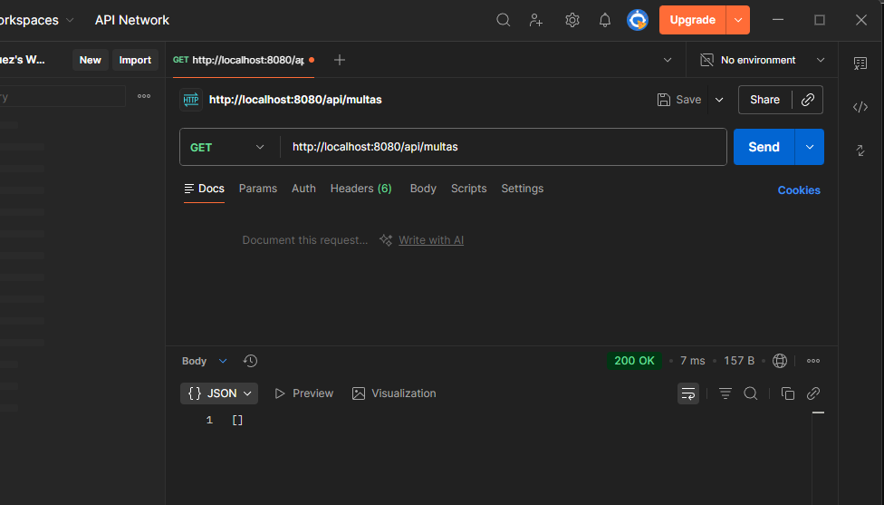
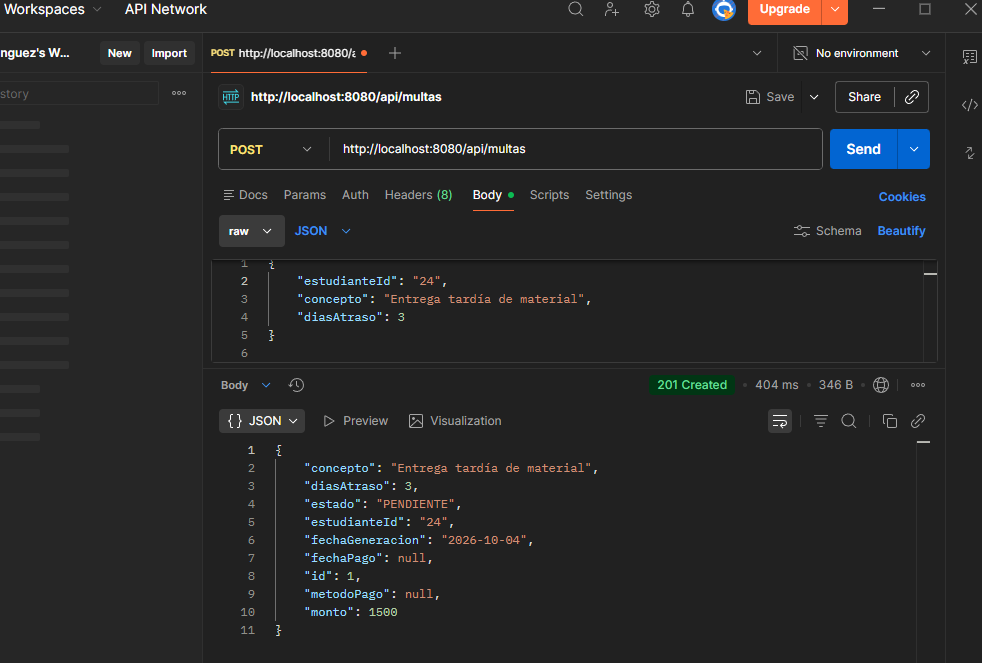
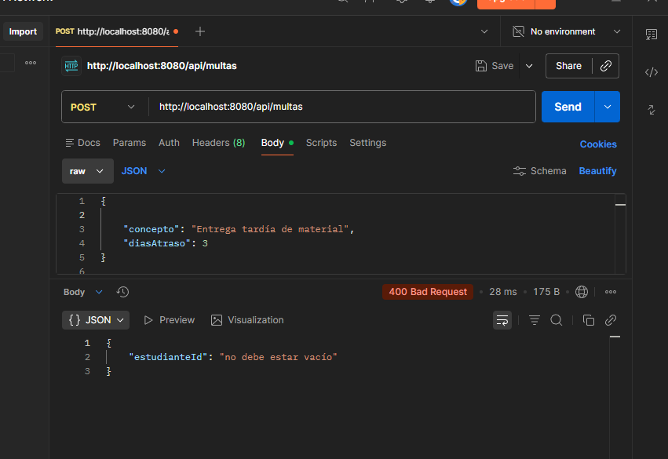
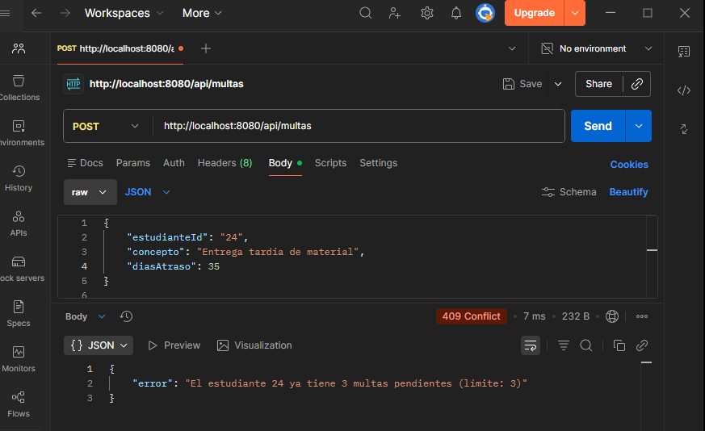
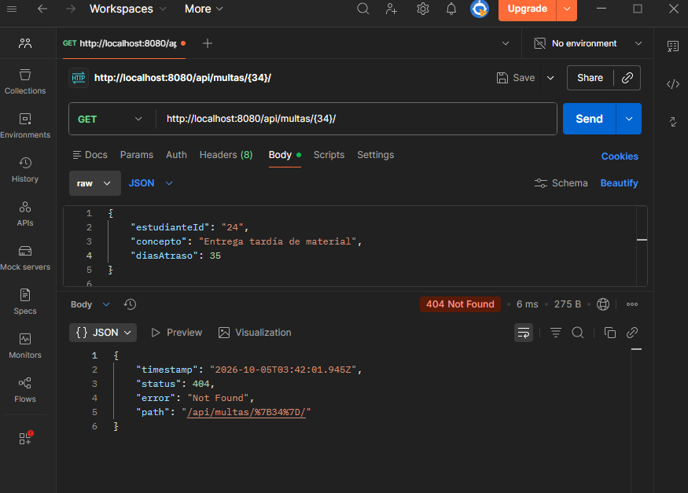
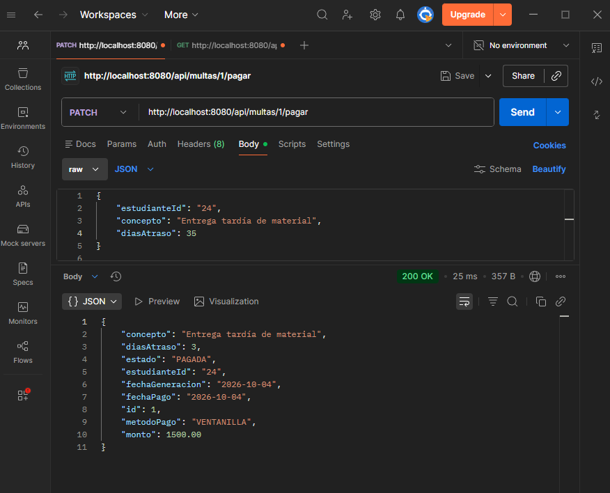
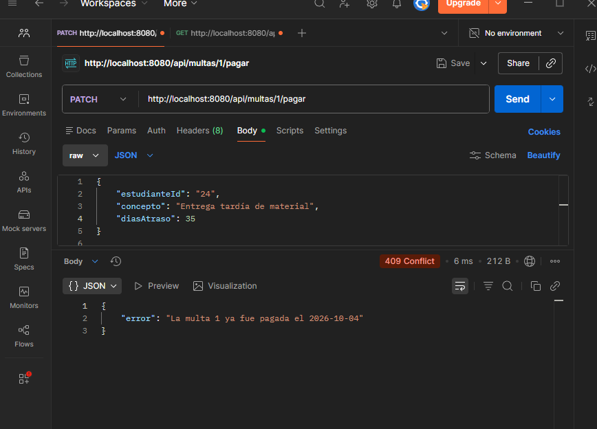

# Post-contenido — Unidad 7: Patrones Arquitectónicos I

## Descripción
Repositorio del post-contenido de la Unidad 7 de Patrones de Diseño
de Software. Un unico proyecto Spring Boot (multas-biblioteca-api)
para la gestion de multas de biblioteca, con dos partes: una API REST
en capas (Model, Repository, Service, Controller) sobre H2, y pago en
linea de multas con dos pasarelas intercambiables.

## Parte 1 — Arquitectura en Capas
MultaRepository extiende JpaRepository y agrega una consulta
agregada (countByEstudianteIdAndEstado). MultaService concentra las
reglas de negocio (limite de multas pendientes, generacion); el
calculo del monto vive en la propia entidad Multa
(Multa.calcularMonto). MultaController expone /api/multas. Ver
paquetes model/, repository/, service/ y controller/.

## Parte 2 — Pago en Linea con Dos Pasarelas
[Documentar aqui la opcion elegida entre A (rama condicional), B
(Strategy en service/) o C (puerto de dominio con adaptadores) y por
que. Si se eligio C: domain/port/PasarelaPagoPort y domain/ResultadoPago
son Java puro; infrastructure/pago/PagosUdesAdapter e
infrastructure/pago/WompiAdapter traducen cada formato HTTP externo
al mismo ResultadoPago; se seleccionan por app.pagos.proveedor sin
tocar MultaController ni el resto de MultaService.]

## Cómo ejecutar
```
$ cd multas-biblioteca-api && mvn spring-boot:run
```

## Herramientas utilizadas
- Java 17, Spring Boot 3.x, Spring Data JPA, H2, RestTemplate
- Apache Maven, Postman/curl, Git, GitHub

## Decisiones de diseño

### Punto de decisión 1 — Cálculo del monto: ¿entidad o Service?
El cálculo del monto se ubicó en Multa.calcularMonto porque la regla solo depende de los valores definidos por la propia entidad. De esta forma, Multa no es solamente un contenedor de datos, sino que también contiene un comportamiento propio relacionado directamente con su estado. La alternativa sería colocar el cálculo dentro de MultaService, pero esto haría que la entidad dependiera del Service para una operación que no necesita ningún dato externo. Además, si el cálculo estuviera únicamente en el Service, se acercaría a un modelo anémico, donde las entidades contienen principalmente datos y la lógica de negocio queda concentrada en los servicios.

### Punto de decisión 2 — Conteo de multas pendientes: ¿consulta o filtrado en memoria?
Para verificar el límite de multas pendientes se utiliza countByEstudianteIdAndEstado, permitiendo que la base de datos realice directamente el conteo. Se descartó obtener todas las multas mediante findByEstudianteId para después filtrarlas con Java, porque no es necesario recuperar registros completos cuando únicamente se necesita conocer su cantidad. De esta manera, MultaService mantiene la decisión de negocio —si el estudiante puede generar otra multa— mientras que MultaRepository se encarga de obtener de forma directa el dato que esa decisión necesita. Ademas, evita cargar en memoria multas que no son necesarias para realizar la validación.

### Documentacion

#### Capturas de pantalla de pruebas con postman en la parte 1










